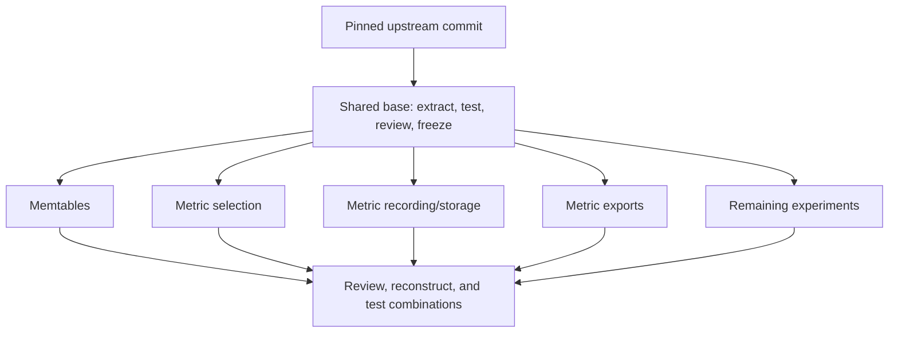

<!--
Licensed to the Apache Software Foundation (ASF) under one or more contributor
license agreements. See the NOTICE file distributed with this work for additional
information regarding copyright ownership. The ASF licenses this file to you
under the Apache License, Version 2.0 (the "License"); you may not use this file
except in compliance with the License. You may obtain a copy of the License at
http://www.apache.org/licenses/LICENSE-2.0
Unless required by applicable law or agreed to in writing, software distributed
under the License is distributed on an "AS IS" BASIS, WITHOUT WARRANTIES OR
CONDITIONS OF ANY KIND, either express or implied. See the License for the
specific language governing permissions and limitations under the License.
-->

# Many-table branch split

This is the canonical planning package for the five-branch split agreed in the
conversation. It replaces the original three-workstream proposal. The copied
background proposal is historical, not an execution instruction.

Status: execution resumed. All five feature branches include corrected shared
base f7d5a7e2c0. MEM and EXTRA use separate merge commits to preserve history;
SELECT, STORE, and EXPORT advanced directly with their worktree edits preserved.
See ../../reviews/ucs-expiration-test-fix.md.
Shared base c6631dcef555d278cbb0f6734a887cc94ee90e1b passed its metric test gate,
build, Checkstyle, generic smoke, and independent review. A later compaction
smoke failed on EXTRA and that base. All five feature worktrees exist; worker
checkpoints remain on disk. See ../../debug/ucs-expiration-validation-blocker.md.

## Location and revisions

Coordinator: /Users/joshua.mckenzie/src/cassandra/cassandra.
Keep this checkout on its current branch. Run all builds in named worktrees.
Do not use the coordinator's HEAD as the extraction base.

- Original source worktree: wt_moar_tables_presplit.
- Source commit: 319995ce5c178f5eb0dbaf135b98d395c40a045c.
- Extraction base: 50a10d42a5d633150fbf4ae518b4da85466472b2.
- Observed local origin/trunk: c38c0da45cd4e5db6b55442c81974e798fcbe2f0.
- Coordinator HEAD: f8e301875d07b29ff840526fe03e5b4bd7567738.
- Original committed delta: 246 paths, 39,140 additions, 305 deletions.
- Existing source changes after that commit are the earlier TODO entry and plan.
  Inspect again before snapshotting. Preserve untracked files explicitly; a Git
  stash snapshot of tracked changes alone does not capture untracked plans.

No remote refresh occurred during planning. Rebase to newer trunk only after
faithful extraction and reconstruction checks pass.

## Worktrees and plan files

All worktrees below are children of the coordinator directory.

| Worktree | Branch | Instructions |
| --- | --- | --- |
| wt_moar_base | many-tables/base | [01-shared-base.md](01-shared-base.md) |
| wt_moar_memtables | many-tables/memtable-residency | [02-memtables.md](02-memtables.md) |
| wt_moar_metric_selection | many-tables/metric-selection | [03-metric-selection.md](03-metric-selection.md) |
| wt_moar_metric_storage | many-tables/metric-storage | [04-metric-storage.md](04-metric-storage.md) |
| wt_moar_metric_exports | many-tables/metric-exports | [05-metric-exports.md](05-metric-exports.md) |
| wt_moar_remaining | many-tables/remaining | [06-remaining.md](06-remaining.md) |
| wt_moar_integration | many-tables/integration | [07-integration.md](07-integration.md) |

Read [08-shared-files.md](08-shared-files.md) for method/hunk boundaries and
[09-path-inventory.md](09-path-inventory.md) for every committed changed path.
Read [background-original-proposal.md](background-original-proposal.md) only for
the earlier findings, measurements, and commit provenance. Later branch placement
decisions in this package take precedence.

## Execution order

1. Recheck source state and target names. Save durable backup references for
   committed source and tracked changes, plus a preserved copy of untracked work.
2. Create only the base worktree. Extract its changes serially. Verify and review
   the base, then record its exact commit in this package.
3. Create all five feature branches at that base commit. Give each executor its
   worktree, branch plan, shared-file allocation, and inventory.
4. Execute independent extractions. Each executor builds and tests its branch.
   Use available worker slots in waves; do not require five simultaneous workers.
5. Review each branch against the frozen base. Resolve findings in that branch.
6. Create the integration worktree, merge branches, restore combined fixtures,
   compare the production tree with the source commit, and test combinations.
7. Report exact branch revisions, checks, adaptations, and the remaining inventory.

Suggested model allocation: Astra for the base decisions and final review; Sol
for feature extraction. Terra can handle an isolated unit with fixed boundaries.
This package does not itself launch agents or select a model for a new session.

The coordinator owns BASE and integration conflict resolution. Workers do not
change BASE independently. A newly discovered shared dependency goes to the
coordinator for one resolution and a recorded base update across all branches.

## Working rules

- Use the final source as the behavioral reference. Do not cherry-pick mixed
  commits wholesale or replace entire shared files to resolve conflicts.
- Preserve all source defaults during extraction. Default changes and redesigns
  are later work. Record unavoidable extraction adapters separately.
- Each worker owns one worktree. Each branch has its own TODO, tmp, logs, build
  outputs, and validation records. Do not share mutable build/test outputs.
- Read-only input is the pinned source commit and source worktree. Do not edit it.
- Use project-local tmp and logs. Preserve stdout/stderr and command exit codes.
- Use ai-build and ai-ci-test wrappers. Do not invoke Ant directly. Run only
  targeted tests, and run wrappers sequentially in a given worktree.
- Schedule heavy builds and tests according to host capacity. Distributed tests
  can share ports across worktrees; allocate distinct ports or run them serially.
- Keep performance measurements free of competing build/test workloads. Never
  rebuild a jar or test classes while a benchmark uses them.
- Preserve existing root changes and unrelated worktrees. Do not delete branches.
- This is local branch preparation. Publishing or opening pull requests is outside
  the current task. Follow the user's commit instructions before making commits.

## Verification of this package

The inventory covers all 246 committed changed paths exactly once. Shared paths
name all owners and route to the semantic hunk map. Production and test paths
must never fall into an unclassified catch-all. Actual moved-test locations and
extraction adaptations must be added by executors as implementation proceeds.

Before execution, recheck the pinned revisions, package links, target-name
availability, installed Java, and applicable worktree instructions. A written
plan is not evidence that a branch builds or that its measured behavior matches.

## Results to fill during execution

| Gate | State | Evidence |
| --- | --- | --- |
| Shared base | Verified and frozen | f7d5a7e2c0fcf769293ee27073630a3574584b06; wt_moar_base/.agentlogs/reviews/ |
| Five standalone branches | Extraction and validation running | MEM build, SELECT/STORE extraction, EXTRA remaining tests |
| Independent reviews | Not started | Review records pending |
| Source reconstruction | Not started | Compared tree and explained differences pending |
| Combined tests | Not started | Test and measurement records pending |
