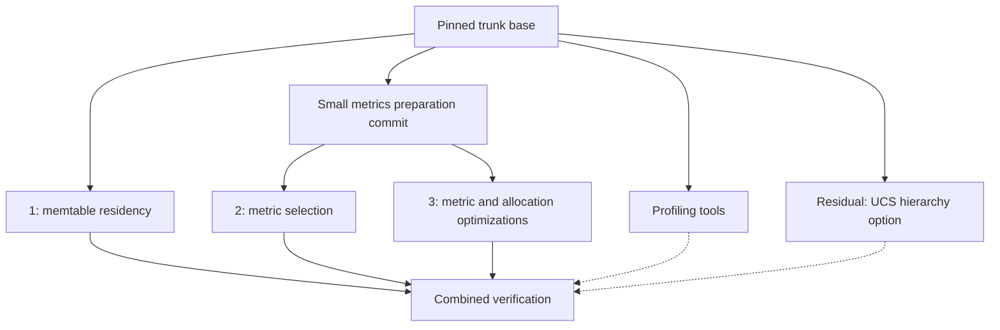

<!--
Licensed to the Apache Software Foundation (ASF) under one or more contributor
license agreements. See the NOTICE file distributed with this work for additional
information regarding copyright ownership. The ASF licenses this file to you
under the Apache License, Version 2.0 (the "License"); you may not use this file
except in compliance with the License. You may obtain a copy of the License at
http://www.apache.org/licenses/LICENSE-2.0
Unless required by applicable law or agreed to in writing, software distributed
under the License is distributed on an "AS IS" BASIS, WITHOUT WARRANTIES OR
CONDITIONS OF ANY KIND, either express or implied. See the License for the
specific language governing permissions and limitations under the License.
-->

# Split the many-table work into independent streams

## Recommendation

Use three feature workstreams, with small review units inside each. Preserve the
current branch as the combined reference. Extract the final changes by feature,
including later repairs. Do not use whole commits as the split boundaries.

Separate the Unified Compaction Strategy (UCS) hierarchy option and the profiling
tools from the production features. Keep an integration branch to test combinations.
Shared test setup must not make one feature depend on another.

This document proposes the split. It does not create branches or certify the code.

## Inspected state

- Source branch: `moar_tables_presplit`, tip `319995ce5c`.
- Shared base with the local `origin/trunk` reference: `50a10d42a5`.
- Local `origin/trunk`: `c38c0da45c`, four commits beyond that base.
- Eleven source commits; initial working tree clean.
- Committed delta: 246 files, 39,140 additions, 305 deletions.
- Of those, 48 paths are under `src/`, including one API document and one catalog.
  These paths contain 4,702 additions and 301 deletions.
- Another 56 paths are tests; 43 are build/profiling tools and root test wrappers;
  80 are research and work records; 19 are configuration or other support files.
- No tracked CODEOWNERS or equivalent owner map was found. Use subsystem review
  boundaries: memtable/flush lifecycle, metric recording/export, JMX, and compaction.

These are local Git facts. No remote refresh, build, or test run was performed.
Research measurements below are prior recorded results, not new measurements.

## Branch structure

Start extraction at `50a10d42a5`. This permits comparison with the exact source
tree before introducing upstream changes. After reconstruction passes, move all
streams to one agreed current trunk revision and rerun their checks.

The small metrics preparation commit contains the shared `ClearableReservoir`
contract and compatible constructor overloads, with the legacy implementation
still selected. `NoOpMetrics` uses this contract; compact reservoirs also use it.
The broader `ThreadLocalTimer` histogram constructor supports no-op latency pairs.
Keep this preparation limited to those actual shared contracts. It must not enable
compact storage, filtering, lazy metric identifiers, or a new default.

This leaves streams 2 and 3 independently buildable above a small common base.
No feature stream needs the full profiling harness to compile or run its core tests.
The harness can consume feature branches through a separate verification checkout.

## Stream 1: memtable residency

Suggested branch: `many-tables/memtable-residency`.

Review units, in order:

1. Lazy TrieMemtable shard allocation and publication, empty reads, and the eager
   control. Include explicit retirement tests that exercise the existing flush path.
2. Optional idle-flush scheduling, eligibility, shutdown, and compaction-strategy
   transitions. Include concurrency, operation-rate, and estimated-byte admission
   limits in the first complete idle-flush feature. Do not ship an unbounded stage.

Primary production paths: `TrieMemtable`, `IdleMemtableFlusher`,
`ColumnFamilyStore`, memtable API documentation, and the idle settings in `Config`,
`DatabaseDescriptor`, and `cassandra.yaml`.

The implementation flushes dirty user tables with lazy TrieMemtable and UCS.
It switches to an uninitialized replacement and releases old storage after reader
reclamation. It retains table metadata, metrics, and SSTable readers. It does not
evict the whole table. Explicit retirement already uses `forceBlockingFlush`;
there is no separate new production retirement API to extract.

Keep these decisions visible: lazy initialization currently defaults to true;
automatic idle flushing defaults to disabled. Admission includes reader retention.
An idle flush failure stops this policy until restart. Estimated-byte admission
does not bound actual disk output or background compaction.

Validation:

- Run lazy, retirement, retirement-failure, flush-set, allocation-accounting,
  recovery, idle-flusher, admission-budget, and idle-configuration tests.
- Preserve first-write races, held readers and writers, flush failure, commit-log
  recovery, truncate/drop, indexes, and CQL/JMX compaction transitions.
- Test ordinary flushes and the disabled policy with original metrics settings.
- Compare never-written tables, burst/idle/reactivate, and continuously active
  tables. Record live memtable storage after reclamation, data correctness, drain
  time, request latency, file counts, and compaction output.
- Separate the `min_hierarchy_size` cases currently in `IdleMemtableFlushTest`.
  Run those on the combined verification branch when the UCS option is present.

Prior evidence: `research/ucs_idle_flush.md` reports 1,124.14 to 142.23 MiB of
settled heap at 1,000 tables. This isolates idle flushing within the already
optimized branch. It is not a measurement of this extracted branch against stock
trunk. Recheck the 32–42 second drain and the subsequent admission changes.

## Stream 2: metric selection

Suggested branch: `many-tables/metric-selection`.

Review units, in order:

1. Correct latency-child release and explicit ownership of hidden recorders.
   Preserve counts and history without merging live siblings twice.
2. Startup profile parsing, required/internal consumers, registration filtering,
   shared no-op destinations, virtual-table behavior, catalog/reference generation,
   profile packaging, and optional legacy aliases.
3. Optional compact table release bookkeeping. Keep this here because it changes
   the ownership structure introduced for hidden metrics. Its linear lookup is a
   separate performance decision, not a prerequisite for filtering.

Primary paths: `MetricProfile`, `NoOpMetrics`, `TableMetrics`, `KeyspaceMetrics`,
the relevant `LatencyMetrics` and registry hunks, `TableMetricTables`, catalog and
profile files, reference generator, and Debian packaging. Field-documentation
changes in Bloom filter, index-summary, and key-cache metric classes support the
generated reference and belong here.

Export selection and recorder removal are different operations. A hidden table
metric can still feed an enabled aggregate or a database decision. Keep those
recorders and their release tracking. Keep legacy-alias selection here; it changes
which exports exist, rather than how an export stores its state.

Revision recommendation: make the shipped configuration preserve all exports for
the first review. Supply `simple_metrics.yml` as an explicit choice. The current
file selects simple metrics, although omitted/null configuration selects all.
Changing that default needs its own compatibility discussion and measurement.
This is a proposed revision, not part of the initial faithful extraction.

Validation:

- Run `MetricProfileTest`, `MetricProfilePropertyTest`, `NoOpMetricsTest`, its
  nested properties, `LatencyMetricsTest`, and distributed registration/recording
  tests. Include compact-bookkeeping lifecycle and property tests for that unit.
- Check omitted, all, simple, custom, invalid, and aliases-on/off profiles. Verify
  required recorders, hidden aggregate inputs, index tables, extension names,
  create/drop/recreate, client initialization, and virtual-table row absence.
- Verify generated catalog/reference freshness and profile inclusion in packages.
- Adapt profile tests to run with legacy reservoirs and eager memtables. Today
  both distributed profile classes enable compact reservoirs and lazy memtables;
  registration tests call `TrieMemtable.isInitialized()`. Move those combined
  assertions into integration coverage, retaining data/flush assertions here.
- Measure retained heap after creation, full scraping, activity, and table churn.
  Use equal reservoir, memtable, and JMX settings on both sides.

Prior evidence: `research/metric_profile_runtime.md` reports 549.47 to 167.93 MiB
after activity and scraping at 1,000 tables. That result predates some later
optimizations. It does not predict the standalone branch's exact saving.

## Stream 3: metric and allocation optimizations

Suggested work branch: `many-tables/metric-storage`. Preserve separate commits
for these review units; split further into branches when each unit is reviewed.

| Unit | Scope | Required verification |
| --- | --- | --- |
| Compact reservoirs | Empty/sparse storage, contention-driven stripes, adaptive-width dense counters, snapshot compatibility, registry/timer factories | Array and reservoir unit/property tests; legacy/compact integration; decay, rebase, clear, overflow, contention, and update benchmarks |
| Adaptive JMX history | `AdaptiveHistogramHistory` and registry scrape cursors | Exact deltas, rollover/widening, independent aliases, both histogram and timer exports; scrape memory and allocation |
| Compact JMX registration | `TransientMetricMBean`, registry adapters, shared rate labels | Metadata, attributes, operations, aliases, registration/removal, gauge-compatible meters, and scrape costs |
| Transient JMX names | `TransientMBeanServerBuilder`, `ObjectNamePropertyPattern`, JVM option | Local and remote boundaries, notifications, authorization, exact/wildcard queries, early/late installation |
| Worker metric residency | Factory reuse, first-use counter identifiers, lazy counter/histogram/meter implementations, affected Bloom filter/key-cache/buffer-pool call sites | Reuse, first-update races, worker exit, cleanup, signed updates, reset, aggregate release, eager-path performance |
| Geometric meter arrays | `GeometricThreadLocalMeter` and meter factory selection | Exact rate/tick equivalence, offset reuse, concurrent registration, allocation versus spare retained capacity |
| Lazy tombstone builder | `LazyTombstoneHistogramBuilder`, builder interface, `MetadataCollector` injection/selection | Empty and populated lifecycles, exact histogram/serialization behavior, allocation and first-observation cost |

The JMX units do not require metric filtering or compact reservoirs. Shared edits
in the registry do not establish a semantic dependency. Geometric meters and lazy
metric identifiers intersect in `LazyGeometricThreadLocalMeter`: order geometric
meters first, or introduce that combined subclass only when both units exist.
Factory reuse can be reviewed before lazy identifiers; it has value on its own.

Do not silently fold latency-release correctness into the reservoir change. The
legacy snapshot hooks required by compact reservoirs stay with compact storage;
the child-release fix stays with stream 2.

Current defaults: compact reservoirs are enabled; adaptive history, compact JMX
registration, transient JMX names, lazy identifiers, geometric arrays, and lazy
tombstone builders are opt-in. All are startup choices.

Compatibility needs precise wording: compact runtime storage preserves cumulative
counts and bucket definitions, but adaptive stripes can change recent-count
rounding. It does not change SSTable histogram formats. Adaptive scrape-history
packing has a separate exact-delta contract.

Keep the performance tradeoffs explicit. Prior worker-counter benchmarks report
roughly 11–19% slower lazy updates. Geometric arrays reduce allocation but retain
spare capacity. The lazy tombstone builder saves temporary spool allocation;
the recorded experiments did not show a material dormant-table residency saving.
Use original exports and memtables for standalone measurements of this stream.

## Residual work

| Item | Disposition |
| --- | --- |
| UCS `min_hierarchy_size` | Separate compaction experiment: Controller, tests, documentation, and benchmark. Idle flushing uses the existing 1 MiB behavior without it. |
| Resource profiler and many-table/memtable/heap-census harnesses | Preserve as shared research tools. Extract a stock-compatible core; add feature adapters in verification checkouts. |
| OpenTelemetry storage and histogram-width experiments | Research benchmarks, not a production OpenTelemetry dependency or a histogram-format migration. |
| Java coverage tool version change | Separate build change: `build.xml` raises JaCoCo 0.8.8 to 0.8.11. It supports Java 21 instrumentation, not feature runtime behavior. |
| Build wrappers, environment workarounds, local ignores, agent-tool assets, and work records | Preserve on the source/tools branch. Move only required reproducible tooling into feature submissions. |
| README additions | Divide feature/operator documentation from branch experiment recipes. Put each with its owner. |
| Tombstone snapshot trimming and SSTable histogram-array sharing | Open ideas only; no implementation for these in the branch delta. |
| Further JMX object reductions, worker-owned metrics, lazy aggregation, and meter registration-list copying | Open research directions, not hidden finished patches. |

The UCS report records about 90% less compaction output for the growing append
workload but more than twice the average reader count. It retained the 1 MiB
default and stopped before the larger validation stages. Keep this result in the
residual discussion rather than using it to justify enabling the option broadly.

## Commit provenance and mixed changes

| Source commit | Extraction use |
| --- | --- |
| `c3fadfb100` | Initial profiling tools |
| `f5f830e5d8` | Split lazy memtables/retirement tests from geometric meters, lazy tombstone builders, and tools |
| `8c5f8ba2d0`, `16102da182`, `02eb0ad009` | Compact reservoir series; take final source and relevant tests, not each historic intermediate experiment |
| `1a38d23df0` | Profiles/catalog/reference versus heap-census tools and research |
| `d16edba477` | Split profile runtime, aliases, latency lifecycle, JMX units, worker metrics, bookkeeping, and research |
| `1096f47ed4` | Distribute startup/test-rebase repairs to their owning streams |
| `731d0ba332` | Idle-flush feature and tests |
| `6c4822c937` | Split admission controls from UCS hierarchy, JaCoCo, and census work |
| `319995ce5c` | Distribute final parser, packing, name-pattern, and idle-scan simplifications with their tests |

Files requiring deliberate hunk allocation include both configuration classes,
`CassandraRelevantProperties`, `CassandraMetricsRegistry`, `LatencyMetrics`,
`ThreadLocalTimer`, `TableMetrics`, `conf/README.txt`, `cassandra.yaml`, root test
wrappers, and the two large profiling harnesses. Some test files also need method
splits; a file-only manifest cannot prove separation.

## Execution and acceptance gates

1. Preserve the current source commit and any then-uncommitted work in a durable
   backup before moving changes. Record exact revisions and effective settings.
2. Make a file/hunk manifest with one owner for every production change and an
   explicit residual entry for every remaining path. Extract final behavior first.
3. Create separate checkouts so builds cannot overwrite another stream's artifacts.
   Save source provenance and required tests with each review unit.
4. Build each stream through the repository Ant wrappers. Run its specific tests
   and style checks. Preserve test results before wrappers clean shared outputs.
   Test wrappers run sequentially within each checkout. Do not run the full suite.
5. Compile the selected sources from scratch. A disabled feature flag is not proof
   that a dependency has been removed. Check startup configurations and packaged
   resources, as well as source imports and constructor signatures.
6. Recombine all extracted units, including residual production changes, and compare
   against `319995ce5c`. Explain every difference. Require no unexplained production
   differences before intentional revisions. Track relocated tests/documents too.
7. Apply proposed revisions in later commits. Keep branch extraction, behavior
   changes, and movement onto newer trunk distinct so failures have a clear cause.
8. Repeat controlled benchmarks for each stream against its exact base. Use 100
   tables for smoke tests, then 1,000 for matched comparisons. Add larger populations
   only after correctness and resource gates pass. Never sum historical savings
   measured against different baselines.
9. Test combinations on the integration branch: profiles with both reservoir modes;
   profiles with retirement and indexes; JMX options with aliases on/off; lazy
   identifiers with both meter implementations. Run the full intended configuration.

Measure allocation separately from retained heap. Keep table count, data, readers,
scrape activity, worker count, Java version, collector, and heap limits matched.
Freeze shared jars and test classes until benchmark processes exit. Record output
under project-local `logs/` with timestamps and preserved command status.

Completion means each feature branch builds and passes its relevant checks alone,
the integration run preserves data and metric contracts, the source reconstruction
has no unexplained difference, and every leftover change has an explicit owner.
